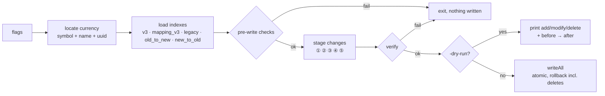
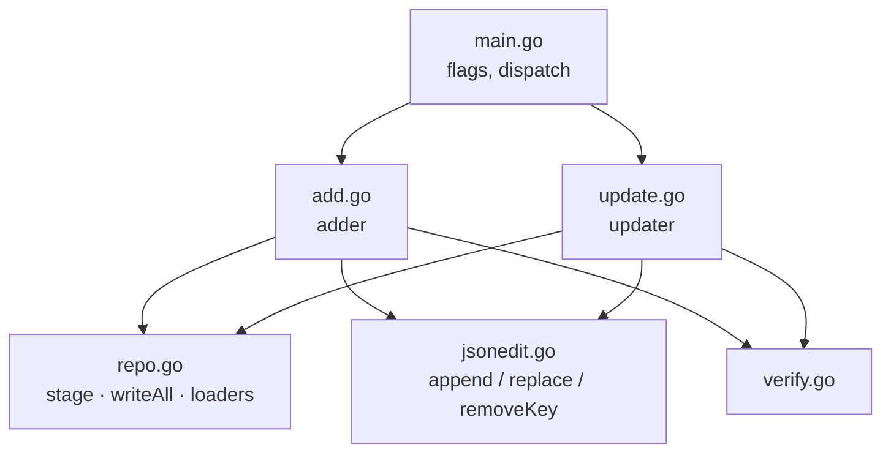
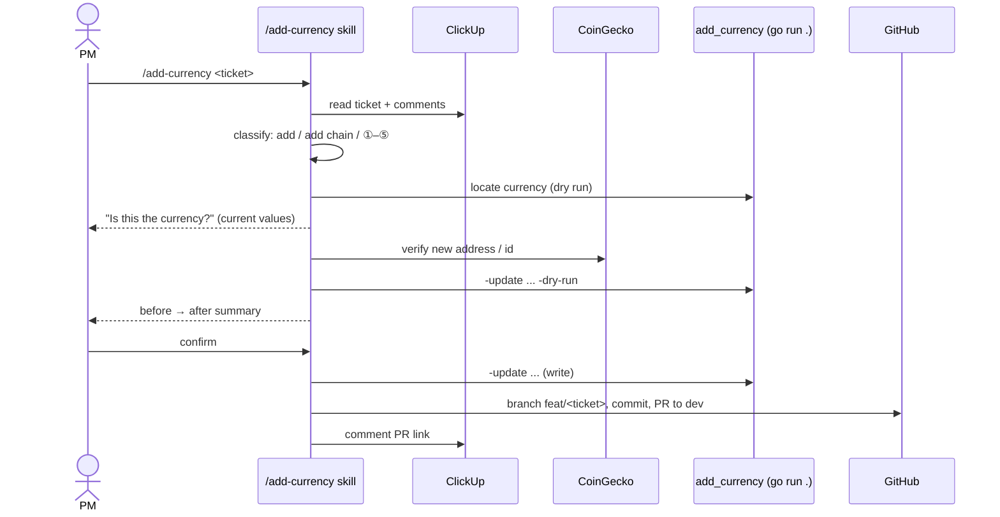

# Plan: Update existing currencies with add_currency / `/add-currency`

> 🔵 In progress — approved 2026-11-02
>
> ClickUp: [SYGN-15034](https://app.clickup.com/t/z8qgvc9krr) (parent [SYGN-15024](https://app.clickup.com/t/z8qgvc7gc9)) · Design draft: [修改幣種功能設計草稿](https://claude.ai/artifact/Fw7ZZEdctkEbqXPEDiFzTk)

## 1. Goal

Extend `tools/add_currency.go` and the `/add-currency` skill so a PM can apply five kinds of change to an existing currency — ① contract address, ② name / symbol, ③ CoinGecko ID, ④ remove a chain, ⑤ delist (optionally delete from v3) — keeping old legacy IDs as `is_active: false`.

**Success criterion:** a PM runs `/add-currency <ticket>` on an "update currency" ticket, sees a before → after dry-run summary, confirms, and gets a PR to `dev`; the changed files are consistent (pass `verify()` and the `assembly-handler` CI); any failed check writes nothing; replaying XAUT (①) and KLAY → Kaia (② + ③) reproduces the historical manual commits, except old legacy files are kept as inactive.

## 2. Context

Today the tool only adds a currency or a chain; any existing value stops with `already exists`, so every update is hand-edited across up to 6 file types. Hand edits have gone wrong: SYGN-18577 replaced the Aptos legacy ID and broke mapping (SYGN-18584, 2026-05-25), fixed by keeping the old file as inactive. PMs already list currencies with the skill (ZIL, PR #248); updates are the remaining manual step.

## 3. Scope

### In scope

- [x] Split `add_currency.go` into several files in `package main`; run with `go run .`
- [x] Go test harness with a small fixture repository; tests for the existing add flow
- [ ] `-update` mode that locates a currency by `-symbol` + `-name` (+ `-uuid`) and never creates one
- [ ] ① `-set-address KEY:ADDR` (token chains)
- [ ] ② `-set-name`, `-set-symbol` (v3 + every legacy file of the UUID, incl. native and inactive ones)
- [ ] ③ `-set-coingecko-id`
- [ ] ④ `-remove-platform KEY`
- [ ] ⑤ `-deactivate`, with optional `-delete-v3`
- [ ] Before → after dry-run output; rollback that also covers deleted files
- [ ] `/add-currency` skill handles update tickets; error table, `tools/README.md`, `CLAUDE.md` updated

### Out of scope (explicit)

- [ ] ① on native platforms (legacy native files stay manual, same as adding)
- [ ] Re-activating an inactive legacy ID
- [ ] Changing KYT provider mappings (`kyt_providers/`) or `blockchain_name/`
- [ ] Any change to `assembly-handler` or Bridge API
- [ ] Merging or deploying without the existing 2-approval review

### Deferred

- [ ] Bulk updates from a CSV / multiple tickets in one run
- [ ] A `-reactivate` flag (only if a real case appears)

## 4. Approach

**Files (`tools/`, all `package main`):**

| File | Contents |
|---|---|
| `main.go` | flag parsing, dispatch to add or update |
| `add.go` | today's `adder.run` / `plan` / `stageMappings` (moved, unchanged) |
| `update.go` | `updater`: locate currency, one `stage*` function per change type |
| `repo.go` | shared I/O: `read`, `stage`, `writeAll`, `checkInsideRoot`, loaders (`loadCoingeckoV3`, `loadLegacyIndex`, `loadV3Addresses`, …) |
| `jsonedit.go` | byte-level edits that keep formatting: `appendToContainer` (moved), new `replaceValue`, `removeKey` |
| `verify.go` | `verify()` cross-checks, extended per change type |
| `*_test.go`, `testdata/repo/` | fixture repo + tests |

`add_currency.sh`, `tools/README.md`, `CLAUDE.md` and the skill switch from `go run add_currency.go` to `go run .`.

**Shared staging model.** Extend the staged file map with a delete marker (`stageDelete(rel)`); `writeAll` snapshots originals for writes *and* deletes and restores both on failure. `checkInsideRoot` applies to deletes too.

**Format-preserving edits.** Mapping files must keep their bytes except the changed line, so updates use targeted edits instead of re-encoding:
- `replaceValue(data, key, oldValue, newValue)` — replace one string value in an object/array entry, error unless exactly one match.
- `removeKey(objBytes, key)` — drop one `"key": "value"` line from the `new_to_old` UUID object, fixing the comma.
- Legacy `cryptocurrency/*.json` files are single-line; re-encode with `encodeJSON(…, "")` (same as today).
- v3 files are re-encoded with 2-space indent (same as today), preserving platform key order.

**Locating legacy files of a currency.** `old_to_new` is the source of truth: every legacy ID mapped to the UUID (active, inactive, native). Each ID → file via `legacyIndex.fileForID` (handles `sygna:` / `sygna-` names).

**Per change (what `stage*` writes):**

| Change | v3 | `mapping_v3` | legacy files | `mapping.json` | `new_to_old` | `old_to_new` |
|---|---|---|---|---|---|---|
| ① `-set-address K:B` | `platforms.K` = B | — | add `<chain>.B`; old `<chain>.A` → `is_active:false` | append B entry | `UUID.K` → B id | append B → UUID |
| ② `-set-name` / `-set-symbol` | `name`; symbol moves the object to `<NEW>.json` (append or create), deletes `<OLD>.json` if empty | — | `currency_name` / `currency_symbol` in all | — | — | — |
| ③ `-set-coingecko-id` | — | UUID value | — | value of every legacy id of UUID | — | — |
| ④ `-remove-platform K` | delete `platforms.K`; refuse if last | — | that file → `is_active:false` | keep | remove `K` | keep |
| ⑤ `-deactivate` [`-delete-v3`] | untouched, or remove the currency (delete file if empty) | keep | all → `is_active:false` | keep | keep | keep |

① reuses the add path's `resolveSygnaID`, `legacyIndex.platformFor`, address validation and duplicate checks. ⑤ cannot be combined with other flags; ① and ④ cannot target the same chain.

**Pre-write checks** (error → nothing written), per the design draft: target chain exists / not last; new address unused on that chain and different from the old one; new name unique in the symbol file (case-insensitive); new symbol passes `symbolRe` and `<NEW>.json` has no same-name currency; new CoinGecko ID differs and is unused unless `-allow-shared-coingecko-id`; ⑤ refuses if every legacy file is already inactive.

**Dry run.** Prints each file as `add` / `modify` / `delete`, then a before → after table (name, symbol, CoinGecko, each chain's address and legacy id + active flag). The skill turns this into the PM summary.

**Skill.** `/add-currency` classifies the ticket (add / add chain / ①–⑤), shows the located currency for confirmation, checks CoinGecko (① address in `platforms`; ③ new id's `platforms` cover current addresses; ② mismatch only warns), dry-runs, waits for confirmation, writes, commits, opens PR `feat: <TICKET> update <Name> (<SYM>) …` with before/after in the body.

## 5. Alternatives considered

### Alternative A: Separate `update_currency.go` tool
- **What**: a second program and wrapper script for updates.
- **Why not**: duplicates loaders, validation, atomic write and `verify()`; PMs and the skill would need two entry points. The single tool with `-update` shares all of it.

### Alternative B: Re-encode whole mapping files after editing in memory
- **What**: unmarshal → modify → marshal `mapping.json`, `id_mapping/*`.
- **Why not**: rewrites thousands of lines (indent, key order, trailing newline differ), making PRs unreviewable and risking unrelated changes. Targeted byte edits keep diffs to the changed lines, as today's append-only approach does.

### Alternative C: Delete old legacy IDs (the XAUT way)
- **What**: replace legacy IDs in place and delete old files.
- **Why not**: rejected on 2026-10-30; the Aptos case showed downstream still resolves old IDs. Old IDs stay as `is_active: false`.

## 6. Diagrams

### Update pipeline (data flow)

### Module layout after PR 1

### PM flow with the skill

## 7. PR Breakdown

Line estimates exclude `testdata/` fixtures. All PRs target `dev`.

Repo convention (`CLAUDE.md`): branch `feat/<ticket>` from `dev` (here `feat/SYGN-15024-<slug>`, one per PR, using the parent ticket), commit subjects `<type>: SYGN-15024 
`, and **squash to a single commit before opening the PR**. The commit lists below are the work steps inside each PR; tick them as they are done, then squash.

### PR 1: Split the tool into files and add a test harness — ~250 lines (plus moved code)
- **Category**: Refactor
- **Branch**: `feat/SYGN-15024-split-add-currency`
- **Goal**: same behaviour as today, code split into files, `go run .`, and tests covering the add flow.
- **Depends on**: none
- **Merge order**: 1st
- **Note**: moving ~1,000 lines shows as a large diff; review with `git diff --color-moved=zebra`. No logic changes in the move commit.
- **Commits**:
  - [x] `docs: SYGN-15024 add plan for updating currencies`
  - [x] `refactor: SYGN-15024 split add_currency.go into main, add, repo, jsonedit and verify`
  - [x] `chore: SYGN-15024 run the tool with go run . in add_currency.sh and docs`
  - [x] `test: SYGN-15024 add fixture repo and tests for adding a currency and a chain`

---

### PR 2: Update mode foundation + ③ CoinGecko ID — ~200 lines
- **Category**: Feature
- **Branch**: `feat/SYGN-15024-update-coingecko-id`
- **Goal**: `-update` locates a currency and `-set-coingecko-id` changes it in `mapping_v3.json` and `mapping.json`, with before → after dry run.
- **Depends on**: PR 1
- **Merge order**: 2nd
- **Commits**:
  - [ ] `feat: SYGN-15024 add -update mode that locates an existing currency`
  - [ ] `feat: SYGN-15024 add replaceValue for format-preserving edits`
  - [ ] `feat: SYGN-15024 support -set-coingecko-id`
  - [ ] `feat: SYGN-15024 print before/after in update dry run`

---

### PR 3: ② name / symbol — ~200 lines
- **Category**: Feature
- **Branch**: `feat/SYGN-15024-update-name-symbol`
- **Goal**: `-set-name` / `-set-symbol` update v3 and every legacy file of the currency; symbol changes move it to `<NEW>.json`.
- **Depends on**: PR 2
- **Merge order**: 3rd
- **Commits**:
  - [ ] `feat: SYGN-15024 stage file deletes with rollback in writeAll`
  - [ ] `feat: SYGN-15024 find all legacy files of a currency via old_to_new`
  - [ ] `feat: SYGN-15024 support -set-name and -set-symbol`
  - [ ] `test: SYGN-15024 replay KLAY to Kaia rename`

---

### PR 4: ① contract address + ④ remove chain — ~200 lines
- **Category**: Feature
- **Branch**: `feat/SYGN-15024-update-address-remove-chain`
- **Goal**: `-set-address` adds the new legacy ID and marks the old one inactive; `-remove-platform` drops the chain from v3 and `new_to_old` and marks its legacy file inactive.
- **Depends on**: PR 3
- **Merge order**: 4th
- **Commits**:
  - [ ] `feat: SYGN-15024 add removeKey and legacy deactivate helpers`
  - [ ] `feat: SYGN-15024 support -set-address`
  - [ ] `feat: SYGN-15024 support -remove-platform`
  - [ ] `test: SYGN-15024 replay XAUT address change`

---

### PR 5: ⑤ delist + skill and docs — ~200 lines
- **Category**: Feature
- **Branch**: `feat/SYGN-15024-delist-and-skill`
- **Goal**: `-deactivate` [`-delete-v3`] delists a currency, and `/add-currency` handles all update tickets so PMs can use the feature.
- **Depends on**: PR 4
- **Merge order**: 5th (PMs only get update support after this one, so they never see a half-finished flow)
- **Commits**:
  - [ ] `feat: SYGN-15024 support -deactivate and -delete-v3`
  - [ ] `feat: SYGN-15024 handle update tickets in /add-currency`
  - [ ] `docs: SYGN-15024 document update mode in tools/README.md and CLAUDE.md`

## 8. Testing strategy

- **Unit tests** (`tools/*_test.go`, run with `go test ./...` in `tools/`):
  - `jsonedit`: `appendToContainer`, `replaceValue`, `removeKey` keep every other byte (compare against expected files); no trailing newline is added.
  - Each change type on a fixture repo in `testdata/repo/` copied to `t.TempDir()`: expected files after the run, and `verify()` passes.
  - Every pre-write check has a failure test that asserts no file in the temp repo changed (hash before/after).
  - Rollback: inject a write failure midway (unwritable directory) and assert originals, including deleted files, are restored.
- **Replay tests**: fixtures built from the parent commits of `3e19eee` (XAUT, ①) and `b112f39` (KLAY → Kaia, ② + ③), trimmed to the touched currency; output must equal the historical commit except old legacy files kept as `is_active: false`.
- **Integration**: the PR CI (`assembly-handler` `npm run check`) is a no-op today (`src/checker.ts` only logs), so it validates nothing. Each PR is instead dry-run against the real repo and checked with `verify()`. `merger.ts` (deploy) looks up `mapping_v3` from v3 currencies, so entries left by `-delete-v3` are ignored.
- **Manual verification**: after PR 5, a PM runs `/add-currency` on one test ticket per change type and stops at the dry-run summary; one real update ticket goes all the way to a PR.
- **Not tested**: CoinGecko lookups and ClickUp/GitHub calls inside the skill (the skill is prompt instructions, verified manually); `add_currency.sh` Go download (unchanged).

## 9. Risks & open questions

- **Assumption**: native platforms are excluded from ① (engineer does it manually); ② and ⑤ still edit native legacy files because only fields change — if PMs need native address changes, add it later.
- **Assumption**: `old_to_new` lists every legacy ID of a currency (verified on `dev`: 2,454 entries, all with a legacy file) — if not, ② / ⑤ would miss files; `verify()` cross-checks v3 → `new_to_old` → files.
- **Assumption**: `-update` refuses ambiguous locates exactly like add (same-name currencies need `-uuid`).
- **Risk**: no CI validates data consistency (`checker.ts` is a TODO) — mitigation: `verify()` cross-checks plus tests for every change type, and a real-repo dry run per PR. `CLAUDE.md` still says CI validates PRs; fixing that is outside this plan.
- **Risk**: PR 1's move makes a big diff — mitigation: move commit has no logic changes; tests land in the same PR and pass before and after.
- **Risk**: PRs 2–4 exceed ~200 lines once tests are counted — mitigation: estimates exclude fixtures; split a PR if review asks.
- **Open**: none blocking (decisions of 2026-10-30 are in the design draft).

## 10. Done criteria

- [ ] PRs 1–5 merged in order into `dev`, each with 2 approvals
- [ ] `go test ./...` passes in `tools/`
- [ ] Each change ①–⑤ works on the real repo in dry run and writes consistent files (`verify()` passes)
- [ ] XAUT and KLAY → Kaia replay tests pass
- [ ] Any failed check leaves the repository unchanged (tested)
- [ ] `/add-currency` on an update ticket shows the before → after summary and opens a PR to `dev`
- [ ] `tools/README.md`, `CLAUDE.md` and the skill describe update mode and `go run .`
- [ ] No new TODOs without a ClickUp ticket

---

## Appendix: decisions log

- 2026-10-30 — Keep old legacy IDs as `is_active: false`; keep their `mapping.json` entries — Aptos (SYGN-18584) showed downstream still resolves old IDs.
- 2026-10-30 — Symbol changes do not affect VASPs.
- 2026-10-30 — Delisting = all legacy files `is_active: false`; v3 untouched unless needed, then delete.
- 2026-10-30 — Update PRs follow the existing rule (2 approvals).
- 2026-11-02 — Split the tool into several files and run it with `go run .`.
- 2026-11-02 — Plan lives in `docs/plans/` of this repo.
- 2026-11-02 — Found that the `assembly-handler` PR check is a no-op (`src/checker.ts` is a TODO); dropped "green CI" from done criteria and the `-delete-v3` CI risk, since `merger.ts` ignores orphan `mapping_v3` entries.
- 2026-11-02 — Branches and commits use the parent ticket SYGN-15024 (not SYGN-15034's task id), per the owner.
